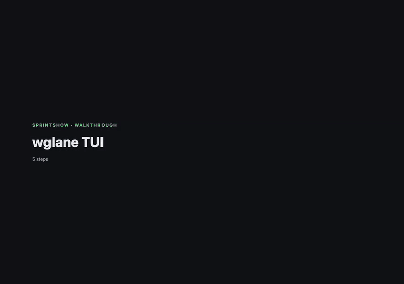

# vpnlane

Use NordVPN (NordLynx/WireGuard) on macOS without breaking Tailscale or
Headscale. One command connects to a Nord country; your tailnet keeps working,
and it keeps working when you change Wi-Fi (leave `vpnlane watch` running in a
terminal for that). Rust CLI and TUI.

> **Upgrading from wglane?** See [Upgrading from wglane](#upgrading-from-wglane) below.

> **Status: pre-alpha.** Unit tested against fakes and smoke-tested by hand on
> one Mac across several networks (home Wi-Fi and two phone hotspots). Not
> audited, no long soak: expect rough edges and run `vpnlane doctor` first.
> macOS only. Prebuilt archives for Apple silicon and Intel are on the
> [releases page](https://github.com/nyashkn/vpnlane/releases) (unsigned: see
> [Install and set up](#install-and-set-up)); Homebrew comes later.
> **Known gap:** IPv6 is not tunnelled; it
> is rejected (best effort) while the tunnel is up (see
> [Security model and known limits](#security-model-and-known-limits)).

## Demo




## Install and set up

**Prebuilt (no Rust needed):** do the prerequisites in step 2 below, then
download the archive for your Mac from the
[releases page](https://github.com/nyashkn/vpnlane/releases), and in the folder
you extract it to run:

```sh
xattr -dr com.apple.quarantine .    # the binaries are not signed or notarized
sudo "$PWD/vpnlane" install-helper   # reads vpnlane-helper from the same folder
./vpnlane doctor
```

Then continue at step 4 (token). Check the download against the `.sha256` file
next to it. Or install from source without a checkout:
`cargo install --git https://github.com/nyashkn/vpnlane vpnlane-cli --locked`
(then step 2 prerequisites, `sudo "$(command -v vpnlane)" install-helper`, step 4). Or build from a clone:

Do these in order.

1. Clone: `git clone https://github.com/nyashkn/vpnlane && cd vpnlane`
2. Prerequisites:
   - macOS with the Xcode Command Line Tools (`xcode-select --install`).
   - Rust, via [rustup](https://rustup.rs).
   - Homebrew packages: `brew install wireguard-tools wireguard-go`.
   - The `tailscale` CLI on your `PATH`. vpnlane needs it to find the control
     server and relays it must protect; without it `up` installs 0 bypass
     routes and the tailnet is not protected. With the Tailscale app: Settings
     > Install CLI.
   - A NordVPN subscription. Quit the Nord app first; two VPNs on one Mac conflict.
3. Build and install: `just install`. It runs the three commands below, with the
   full path to `vpnlane` because `sudo` does not search `~/.cargo/bin`:

   ```sh
   cargo install --path crates/vpnlane-cli --locked   # vpnlane and vpnlane-helper
   sudo "$(command -v vpnlane)" install-helper        # one time, asks for your password
   vpnlane doctor                                     # what is still missing, and the fix
   ```

   After this, `up` and `down` need no password.
4. Create an access token and save it in the same step. Click path and
   details: [docs/TOKEN.md](docs/TOKEN.md) (Nord Account > NordVPN > Advanced
   settings > Get access token). Copy it, then:

   ```sh
   mkdir -p ~/.config/vpnlane && (umask 077; pbpaste > ~/.config/vpnlane/token)
   ```

   Or `export VPNLANE_TOKEN=...` (the env var wins over the file). Never pass
   the token as an argument.
5. `vpnlane doctor` should print `ok` on every line.
6. `vpnlane up US`, then `vpnlane status`: the exit IP is Nord's and `tailnet`
   says `ok`. Run `vpnlane down` when done. (`up` leaves the rendered key in a
   root-only state directory until `down` removes it.)

## Quickstart

```sh
vpnlane doctor      # what is still missing, and the fix
vpnlane up US       # connect; the exit IP is Nord's, your tailnet keeps working
vpnlane status
vpnlane down
```

Optional short alias: `eval "$(vpnlane alias)"` defines `vl` for this shell
(`echo "$(vpnlane alias)" >> ~/.zshrc` keeps it; `--shell bash|fish`, `vpnlane alias NAME` for another name).
`vpnlane alias` only prints; it never edits a file. Load the completions too:
`vpnlane completions zsh`.

**Why `sudo`?** One root helper, installed once with `sudo vpnlane install-helper`, is the only privileged piece: it runs only `wireguard-go` and `wg` (plus `ifconfig`/`route`) through one sudoers rule, so `up` and `down` need no password afterwards. See the [diagram](#how-it-works-with-tailscale) and [Why sudo, exactly](#why-sudo-exactly).

<details>
<summary>Using it: all commands</summary>

```sh
# Token saved as in "Install and set up" above.
vpnlane up ZA        # connect (the config is generated or refreshed as needed)
vpnlane status       # country, exit IP, tailnet check, bypass routes
vpnlane down
vpnlane tui          # dashboard: status home, space to jump to a city or preset, 1-9 apply presets
vpnlane watch        # re-apply bypass routes when you change networks
vpnlane doctor       # checks wg, tailscale, helper, sudoers, token, config dir
vpnlane up US/Chicago    # a city (same as `up US --city Chicago`); `vpnlane up -` repeats the last request
vpnlane ls US        # cities of a country with their server counts
vpnlane servers US   # ranked servers with their city (--city NAME to filter)
vpnlane ls           # list countries
vpnlane gen ZA       # write the WireGuard config without connecting
vpnlane completions zsh   # shell completions
sudo "$(command -v vpnlane)" install-helper --uninstall   # remove the helper
```

`vpnlane --help` and `vpnlane <command> --help` have examples for everything.
`--json` works on every command, `-v`/`-vv`/`-vvv` add log output, and
`--config-dir` (or `VPNLANE_CONFIG_DIR`) moves the config directory.
Dashboard keys and states: [docs/TUI.md](docs/TUI.md).

Saved settings (`config.toml`: one `location` value, `pick`, extra bypass CIDRs, TUI options, and presets that overlay them, applied with `vpnlane preset apply NAME`; what vpnlane last applied lives in `state.json`, never in your config): [docs/CONFIG.md](docs/CONFIG.md).

</details>

<details>
<summary><a id="why-sudo-exactly"></a>Why sudo, exactly (helper verbs, sudoers rule, what it can and cannot do)</summary>

Bringing a tunnel up and editing routes needs root; vpnlane itself does not run
as root. `sudo vpnlane install-helper` copies a small helper to a root-owned path
and adds one sudoers rule that lets you run only that binary without a password.
The helper has four fixed verbs, takes no paths from the caller, runs no shell,
and refuses bypass routes unless the gateway is the real physical gateway. It
needs `wg` and `wireguard-go` from Homebrew: `install-helper` copies them into a
root-owned directory, so after upgrading either, re-run it. Anything that can run
commands as your user can use the helper, so treat it as a capability of your
account, not isolation from it. Full design:
[ARCHITECTURE.md, "Privilege split"](docs/ARCHITECTURE.md#privilege-split) and
"Trusted install" in the same section.

Verbs: `up <cc>`, `down`, `active`, `bypass <gw> [<cidr>...]`. Every verb runs under one `flock` on the state directory.

</details>

<details>
<summary><a id="how-it-works-with-tailscale"></a>How it works with Tailscale (bypass routes, IPv6 block, watch)</summary>

A full WireGuard tunnel (`AllowedIPs = 0.0.0.0/0`) also captures Tailscale's
own underlay traffic: the control server and the DERP relays. `tailscale
netcheck` then reports `UDP: false` and the tailnet dies, even though
`100.64.0.0/10` still routes. The Nord macOS app, and `wg-quick` with a
`DNS =` line, also replace the resolver and break MagicDNS.

vpnlane brings the tunnel up without a `DNS =` line and adds host routes via
your physical gateway for the control server and every DERP IP. The tailnet
keeps working; everything else exits through the VPN.

vpnlane is not affiliated with Nord Security. It uses Nord's public API to
fetch your WireGuard key and server list.

```
 you ── vpnlane up ZA ──┐
                       ▼
   ┌──────────────────────────────┐   unprivileged (your user)
   │ vpnlane  (CLI / TUI / watch)  │   token ─▶ Nord API ─▶ za.conf (key + server)
   └───────────────┬──────────────┘
                   │ sudo, one rule, one binary
                   ▼
   ┌──────────────────────────────┐   root, no shell
   │ vpnlane-helper                │   wireguard-go + wg + ifconfig + route
   └───────────────┬──────────────┘
                   ▼
   routing table
     0.0.0.0/1, 128.0.0.0/1 ──────────────▶ utunN ─▶ Nord (everything else)
     Nord server /32      ─┐
     Tailscale control /32 ├─ via your real gateway (en0), NOT the tunnel
     every DERP relay /32 ─┘
     100.64.0.0/10 ──────────────────────▶ Tailscale (unchanged)

   vpnlane watch: Wi-Fi changes ─▶ re-point those host routes at the new gateway
```

Surviving a Wi-Fi change needs `vpnlane watch` running in the foreground. Without
it the routes keep pointing at the old gateway.

The tunnel's own packets and Tailscale's underlay must skip the tunnel or the
tailnet dies. That is the whole trick: host routes via the physical gateway,
no `DNS =` line, and a watcher that keeps them correct as networks change.

</details>

<details>
<summary>Config and presets</summary>

Saved settings live in `~/.config/vpnlane/config.toml`: one `location`, `pick` (`least-load` or `fastest`), extra bypass CIDRs, TUI options, and presets that overlay them. Apply one with `vpnlane preset apply NAME`, or `vpnlane up --preset NAME`. What vpnlane last applied lives in `state.json`, never in your config. Environment variables are `VPNLANE_*` (`VPNLANE_CONFIG_DIR`, `VPNLANE_TOKEN`, `VPNLANE_LOCATION`, `VPNLANE_PICK`, `VPNLANE_PRESET`); `vpnlane config` shows what is in effect.

Full reference, precedence and a worked example: [docs/CONFIG.md](docs/CONFIG.md).

</details>

<details>
<summary>TUI keys</summary>

`vpnlane tui` is palette-first: home is a status HUD with your presets and the fastest places right now.

| Key | Does |
|---|---|
| `space`, `:` | open the jump palette (type a city, country, preset or action) |
| `1`-`9` | apply that preset now |
| `0` | repeat the last request |
| `p` | preview presets |
| `f` | connect to the fastest place measured right now |
| `b` | browse the continent tree |
| `d` | disconnect |
| `r` | recheck |
| `?` | help |
| `q`, `esc` | quit |

All keys and states: [docs/TUI.md](docs/TUI.md).

</details>

<details>
<summary>Choosing a fast exit (latency numbers)</summary>

`pick = "fastest"` (or `vpnlane up --pick fastest`, `--fastest`) pings the 10 least-loaded candidates at once (one ICMP echo each, 2 s at most) and takes the lowest round trip; ties go to the lower load. The summary line shows the result, for example:

```
connected to DE, config regenerated, 12 bypass routes, server de1622.example load 19% latency 41 ms
```

If no server answers, the least-loaded one is used and the summary says so. While a tunnel is up the pings are bound to the physical interface and may all fail; run `vpnlane down` first to measure. `vpnlane servers CC --probe` shows a PING column next to the load. Details: [docs/CONFIG.md](docs/CONFIG.md#pick--fastest-and---pick-fastest).

</details>

<details>
<summary>Troubleshooting</summary>

- `doctor` names the missing piece and the fix. Start there.
- Internet works but the tailnet is down: run `vpnlane status`. If bypass routes
  read `0`, check that `tailscale status` works and the `tailscale` CLI is on
  your `PATH`, then run `vpnlane up <CC>`.
- After switching Wi-Fi with no `vpnlane watch` running, routes point at the old
  gateway. Run `vpnlane watch` (leave it open) or `vpnlane up <CC>` again.
- After upgrading `wireguard-tools`/`wireguard-go`: `sudo vpnlane install-helper`.

</details>

<details>
<summary><a id="upgrading-from-wglane"></a>Upgrading from wglane</summary>

The project was renamed from `wglane`; `vpnlane` reads neither `~/.config/wglane` nor any `WGLANE_*` variable. Short version: bring the old tunnel down with the old binary, install vpnlane, run `sudo vpnlane install-helper` (it migrates the root helper, sudoers rule and state, and refuses while an old tunnel may be up), move `~/.config/wglane` to `~/.config/vpnlane`, rename `WGLANE_*` variables to `VPNLANE_*`. Full steps: [docs/UPGRADING.md](docs/UPGRADING.md).

</details>

<details>
<summary><a id="security-model-and-known-limits"></a>Security model and known limits</summary>

vpnlane is pre-alpha and has not been audited. What it does not protect against:

- IPv6. The Nord config is IPv4-only, so while a tunnel is up vpnlane adds
  reject routes for global IPv6 (`2000::/3`) and the NAT64 prefixes
  (`64:ff9b::/96`, `64:ff9b:1::/48`), and apps should fall back to IPv4 through
  Nord. This is best effort and not a kill switch: sockets bound to a physical
  interface can bypass unscoped routes, and if the tunnel drops IPv4 is not
  blocked. Tailscale's IPv6 underlay path may be cut too and may fall back to
  IPv4/DERP (which have bypass routes); this is unverified.
- The sudo rule is a capability of your account. Any process running as you can
  use the helper to send host traffic (`0.0.0.0/1` + `128.0.0.0/1`) to any
  WireGuard peer on the NordLynx port, with keys that process chooses.
  Endpoints are not limited to Nord servers.
- `install-helper` trusts the `/opt/homebrew/bin` and `/usr/local/bin` symlinks and the running
  executable (`current_exe`) at install time. If either was already replaced,
  root copies the replacement. `otool -L` does not see `dlopen`,
  `LC_DYLD_ENVIRONMENT` or `LC_LOAD_DYLINKER`, so the dependency check is a
  filter, not a proof.
- Tunnel records survive reboot but `utunN` numbers are reused. A record is
  trusted only while its control socket is the same file (device, inode) from
  the same boot; otherwise it is dropped and nothing is torn down. A tunnel
  whose `wireguard-go` died on its own therefore leaves its endpoint host route
  behind until you remove it (`sudo route delete <endpoint>`).
- `/var/run` is `root:daemon 0775` on macOS; the helper accepts that and trusts
  the `daemon` group. A user added to `daemon` defeats the run-dir check.

</details>

<details>
<summary>Uninstall</summary>

```sh
sudo "$(command -v vpnlane)" install-helper --uninstall   # remove the helper, sudoers rule and root state
cargo uninstall vpnlane-cli                              # if installed with cargo
rm -r ~/.config/vpnlane                                  # optional: token, configs, presets
```

Run `vpnlane down` first if a tunnel is up.

</details>

## Development

See [CONTRIBUTING.md](CONTRIBUTING.md) and
[docs/ARCHITECTURE.md](docs/ARCHITECTURE.md). The gate is `just ci`.

## License

MIT. See [LICENSE](LICENSE).
